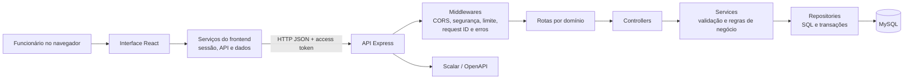
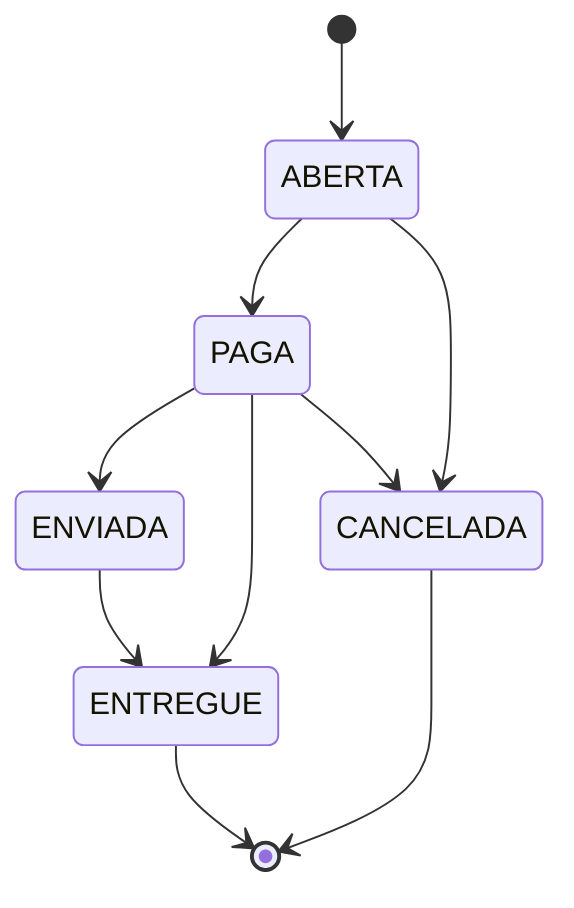
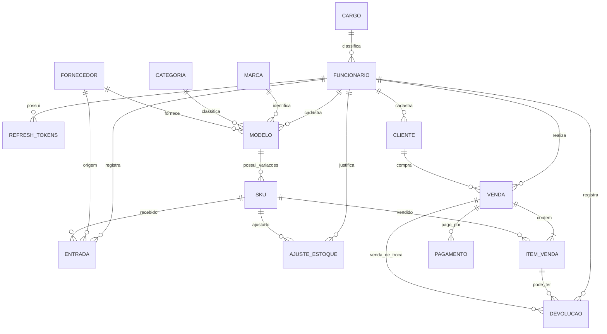

# Nômade — documentação completa para apresentação

> **Objetivo deste documento:** explicar, de forma prática e técnica, como o
> Nômade funciona hoje, quais problemas resolve, como as partes se comunicam,
> quais regras protegem o estoque e quais capacidades estão disponíveis na
> interface ou somente pela API. O conteúdo descreve a implementação existente
> no repositório, e não uma lista de funcionalidades futuras.

## 1. Resumo executivo

O **Nômade** é um sistema web para apoiar a operação de uma loja de calçados.
Seu foco é acompanhar as variações vendáveis dos produtos — isto é, cada
combinação de **modelo, tamanho e cor** — e registrar os acontecimentos que
alteram o saldo: recebimentos, vendas, devoluções reutilizáveis, cancelamentos
e ajustes.

O sistema reúne:

- **Visão operacional:** painel com totais de estoque, alertas de reposição e
  recebimentos recentes.
- **Consulta de estoque:** pesquisa, filtros, paginação, detalhes de SKU e
  exportação CSV.
- **Catálogo:** consulta de marcas e modelos e criação de marcas/modelos pela
  interface.
- **Movimentações:** formulários de entrada, venda, devolução/troca e ajuste,
  além de histórico consultável.
- **Relatório de estoque:** totais e agrupamentos por marca, com exportação.
- **Equipe e cargos:** administração de funcionários e níveis de acesso para
  usuários administradores.
- **API REST:** oferece operações adicionais de cadastro e consulta que ainda
  não têm formulário próprio na aplicação web.

Uma escolha central de arquitetura é manter o saldo corrente no SKU, mas
atualizá-lo por meio dos serviços de negócio. Operações que podem afetar a
consistência do saldo são agrupadas em transações no MySQL. Assim, por exemplo,
uma venda não é considerada concluída parcialmente: ou grava venda, itens,
pagamentos e baixa de estoque em conjunto, ou a operação é revertida.

## 2. O que o produto representa

### 2.1 Vocabulário usado no sistema

| Termo | Significado no Nômade |
|---|---|
| **Marca** | Fabricante ou marca comercial, como Nike ou Vans. |
| **Categoria** | Classificação do modelo, como corrida, casual ou infantil. |
| **Modelo** | Produto-base, por exemplo, um determinado modelo de tênis. O modelo relaciona marca e categoria. |
| **SKU** | Unidade específica que pode ser recebida e vendida: modelo + tamanho + cor. Possui código de barras, preços, estoque mínimo e saldo. |
| **Entrada** | Recebimento de unidades de um SKU, identificado por quantidade e lote. |
| **Venda** | Operação com um ou mais itens/SKUs, um canal, um estado e, opcionalmente, cliente e pagamentos. |
| **Devolução** | Registro da devolução de parte ou de toda a quantidade de um item vendido. |
| **Troca** | Registro de devolução associado a uma nova venda já existente. |
| **Ajuste** | Correção manual de saldo, para adicionar ou remover unidades, com justificativa. |
| **Cargo** | Nome e nível numérico de acesso associados a um funcionário. Nível 100 ou superior é administrador. |

O SKU é a unidade fundamental do controle de estoque. Dois pares do mesmo
modelo, mas de tamanhos ou cores diferentes, são SKUs distintos e têm saldos
independentes.

### 2.2 Problema operacional atendido

O sistema centraliza informações que, sem um registro comum, tenderiam a ficar
espalhadas entre planilhas, anotações ou processos manuais:

1. Quais variações de calçado estão cadastradas?
2. Quantas unidades estão disponíveis em cada variação?
3. Quais itens chegaram em cada lote?
4. Quais vendas, devoluções e trocas foram registradas?
5. Quais SKUs chegaram ao nível mínimo de reposição?
6. Quem realizou uma operação?
7. Quais funcionários podem administrar a equipe e operações restritas?

## 3. Arquitetura em uma visão

### 3.1 Interface web

- Implementada com **React 19** e **Vite**.
- Mantém oito documentos HTML de entrada: `index`, `login`, `dashboard`,
  `inventory`, `registration`, `movements`, `reports` e `users`.
- Cada HTML fornece o contêiner React; `src/main.jsx` inicializa a aplicação,
  e `src/App.jsx` seleciona a página conforme o identificador da página no
  documento.
- Componentes compartilhados ficam em `frontend/src/components`; páginas,
  em `frontend/src/pages`; chamadas HTTP, sessão, formatação e dados, em
  `frontend/src/services`.
- O endereço da API pode ser configurado por `VITE_API_URL`; sem essa
  configuração, o padrão é `http://localhost:3000`.
- O servidor Vite de desenvolvimento usa a porta 5173. A prévia de build usa
  4173.

### 3.2 API e backend

- Implementados com **Node.js** e **Express 5**.
- `backend/src/server.js` carrega a configuração, valida a configuração JWT,
  testa a conexão MySQL e só então começa a escutar na porta `PORT` (3000 por
  padrão).
- `backend/src/app.js` configura middlewares, documentação pública, rota
  informativa, autenticação e os grupos de rotas.
- Cada domínio segue, em geral, a separação:
  **Routes → Controller → Service → Repository**.
- Cadastros semelhantes reaproveitam as fábricas de CRUD em
  `backend/src/shared/lib/crud.js`; vendas, entradas e devoluções têm lógica
  especializada nos respectivos serviços e repositórios.
- `mysql2/promise` é usado com pool de até 10 conexões.
- A documentação interativa da API é servida pelo Scalar em `/api-docs`; o
  contrato OpenAPI fica disponível em `/api-docs/openapi.json`.

### 3.3 Modelo técnico e decisões de arquitetura

#### Estilo arquitetural

O sistema usa uma arquitetura **cliente-servidor em camadas**, com API REST
entre a interface e a persistência. A separação é intencional: o navegador
cuida da interação, enquanto o servidor continua responsável por validar
permissões, aplicar regras de negócio e controlar as gravações.

No backend, a organização é modular por domínio (autenticação, funcionário,
catálogo, entrada, venda, devolução, ajuste e estoque), e não por uma única
coleção de controllers genéricos. Dentro de cada domínio, as responsabilidades
são distribuídas assim:

| Camada | Responsabilidade técnica |
|---|---|
| **Routes** | Declara métodos e caminhos HTTP; conecta middlewares e controllers. |
| **Controller** | Converte parâmetros, corpo e identidade autenticada em chamadas de serviço; escolhe o status HTTP e encaminha falhas ao middleware central. |
| **Service** | Valida regras de negócio, coordena operações e transforma erros conhecidos em respostas de domínio. |
| **Repository** | Encapsula SQL e acesso ao pool; implementa transações, bloqueios e consultas do domínio. |
| **Config/Schema** | Define regras declarativas de CRUD, configuração de ambiente e estrutura relacional do MySQL. |

O frontend segue uma arquitetura multipágina: cada arquivo HTML é uma entrada
do Vite e inicializa a aplicação React para a tela indicada no documento. Há
compartilhamento de componentes e serviços entre as entradas, mas não há um
roteador de cliente que transforme o projeto em uma SPA de rota única.

#### Contratos entre as camadas

- A comunicação entre navegador e API é HTTP com JSON.
- A autenticação envia o access token no cabeçalho `Authorization`; dados de
  cadastro e movimentos seguem o contrato descrito em [ROTAS.md](ROTAS.md).
- O backend injeta a identidade de quem está autenticado em operações que
  registram autoria — por exemplo, funcionário responsável por uma venda —
  em vez de confiar no ID de funcionário informado pelo navegador.
- A aplicação possui convenções de nomes diferentes entre alguns recursos:
  cargos, marcas e modelos usam respostas camelCase; estoque, funcionários e
  vendas preservam nomes SQL em snake_case; entradas e devoluções usam
  camelCase. Isso faz parte do contrato atual, não é uma conversão global.
- O repositório CRUD genérico recebe configuração explícita de tabela, chave
  primária, colunas permitidas, campos graváveis, validação e política de
  exclusão lógica. A lista declarada de colunas graváveis evita aceitar
  automaticamente qualquer propriedade arbitrária do corpo HTTP.
- Domínios transacionais, como venda, têm repositories próprios para controlar
  a ordem de bloqueio, transação e confirmação dos registros relacionados.

#### Bibliotecas e ferramentas

As versões abaixo são as faixas declaradas nos manifests (`^` indica uma
faixa compatível, não necessariamente a versão exata instalada).

**Frontend**

| Biblioteca/ferramenta | Versão declarada | Uso observado |
|---|---:|---|
| `react` | `^19.2.0` | Componentes funcionais, composição da interface, estado local e hooks. |
| `react-dom` | `^19.2.0` | Montagem da aplicação React no elemento raiz de cada HTML. |
| `vite` | `^7.1.12` | Servidor de desenvolvimento, build multipágina e servidor de prévia. |
| `node:test` | Integrado ao Node.js | Testes do cliente HTTP e de funções do frontend, sem runner externo no frontend. |

Não há Redux, biblioteca de estado global ou biblioteca de roteamento declarada
no frontend. O estado de cada tela é controlado com hooks do React; a sessão é
mantida no `sessionStorage`.

**Backend**

| Biblioteca/ferramenta | Versão declarada | Uso observado |
|---|---:|---|
| `express` | `^5.2.1` | Servidor HTTP, roteamento e pipeline de middlewares. |
| `mysql2` | `^3.23.3` | Driver MySQL com API Promise, pool e execução de SQL parametrizado. |
| `bcrypt` | `^6.0.0` | Hash de senhas e comparação no login. |
| `jsonwebtoken` | `^9.0.3` | Assinatura e verificação de tokens JWT de acesso e renovação. |
| `dotenv` | `^17.4.2` | Leitura da configuração de ambiente do backend. |
| `cors` | `^2.8.6` | Política de origens e métodos permitidos para chamadas do navegador. |
| `helmet` | `^8.3.0` | Cabeçalhos HTTP de segurança. |
| `compression` | `^1.8.1` | Compressão de respostas HTTP. |
| `express-rate-limit` | `^8.6.1` | Limite geral de requisições e limite mais restrito para login. |
| `winston` | `^3.19.0` | Registro estruturado de eventos e erros em logs. |
| `@scalar/express-api-reference` | `^0.10.26` | Interface navegável da referência da API em `/api-docs`. |
| `ip-address` | `^10.7.6` | Dependência declarada no manifest; não foi identificada chamada direta no código de aplicação revisado. |
| `uuid` | `^14.0.1` | Dependência declarada; o identificador de requisição observado é gerado pelo módulo nativo `crypto` do Node.js. |

**Desenvolvimento e testes do backend**

| Biblioteca/ferramenta | Versão declarada | Uso observado |
|---|---:|---|
| `jest` | `^30.5.1` | Execução dos testes do backend, inclusive no modo sequencial (`--runInBand`). |
| `supertest` | `^7.3.1` | Testes HTTP da aplicação Express sem iniciar um servidor externo. |
| `swagger-autogen` | `^2.23.7` | Geração do arquivo OpenAPI a partir das rotas e da configuração declarativa dos cadastros. |
| `node --watch` | Integrado ao Node.js | Reinicialização do backend durante o desenvolvimento. |

O backend usa CommonJS (`require`/`module.exports`); o frontend declara módulos
ES (`"type": "module"`). O projeto não declara um ORM: o acesso relacional é
feito diretamente pelos repositories com `mysql2`, SQL e parâmetros. Também
não há camada GraphQL; o contrato externo é REST/JSON.

#### Pipeline de middlewares do backend

Em termos gerais, as requisições atravessam:

1. `helmet` e compressão de respostas;
2. atribuição/propagação de `requestId` e logging da conclusão HTTP;
3. limite geral de requisições;
4. CORS e análise de JSON/formulários com limite de tamanho;
5. documentação pública e rota informativa;
6. rotas de autenticação públicas;
7. verificação JWT aplicada antes dos grupos de rotas protegidas;
8. middleware final de rota não encontrada e tratamento centralizado de erros.

O login possui ainda um limitador próprio mais estrito. Em produção, a API
configura a confiança em um proxy para que os limites por IP possam usar o IP
do cliente conforme a infraestrutura implantada.

#### Como as regras ficam testáveis

- Serviços podem receber repositories por parâmetro quando a lógica exige
  colaboração entre entidades; isso permite substituir persistência em testes.
- Os testes cobrem serviços e também endpoints HTTP com persistência
  simulada. Essa estratégia valida contratos e regras, mas não substitui a
  execução contra um MySQL real para testar bloqueios e concorrência.
- A validação de domínio fica no backend. Validações de formulário no
  frontend melhoram a experiência, mas não são tratadas como fronteira de
  segurança.
- A API centraliza erros de aplicação e traduz problemas comuns do banco
  (como duplicidade, referência inexistente e restrições) para códigos HTTP
  adequados; falhas internas são registradas sem expor SQL ou stack trace ao
  cliente.

### 3.4 Persistência

- O banco é **MySQL 8.0.16 ou superior**, com tabelas InnoDB, chaves
  estrangeiras, índices, valores enumerados e restrições `CHECK`.
- O schema cria o banco `nomade`, além das tabelas e cargos iniciais.
- O saldo é armazenado em `sku.quantidade_estoque`. A view
  `vw_estoque_atual` apresenta uma leitura consolidada para a consulta do
  estoque; ela não é a fonte de atualização do saldo.
- As rotinas da aplicação alteram a coluna do SKU e gravam os registros de
  movimento correspondentes no mesmo fluxo transacional.

## 4. Como uma requisição percorre o sistema

1. Uma página React reúne os dados do formulário ou da consulta.
2. O serviço HTTP do frontend serializa o corpo JSON e, quando há sessão de
   API, envia o token de acesso no cabeçalho `Authorization`.
3. A API associa um `requestId`, registra a requisição, aplica os middlewares
   comuns e encontra a rota correspondente.
4. A rota chama o controller. O controller extrai parâmetros HTTP e delega o
   trabalho à camada de serviço.
5. O serviço valida dados e regras do domínio, e chama o repository.
6. O repository executa consultas parametrizadas. Quando necessário, abre uma
   transação, bloqueia registros relevantes e confirma ou reverte as
   alterações.
7. A API retorna JSON com os dados ou um erro estruturado.
8. A interface atualiza a consulta relacionada, informa o resultado e mantém
   visíveis os erros que precisam da atenção do usuário.

O hook `useResource` carrega um recurso por vez. Por isso, se uma seção do
painel falha, outra seção ainda pode apresentar os dados que conseguiu
consultar; o erro é exibido para a seção afetada, em vez de ser convertido
silenciosamente em uma resposta vazia.

## 5. Funcionalidades da interface

### 5.1 Login e demonstração

**Entrada:** `login.html` (a página inicial também conduz à área de acesso).

- O funcionário entra com e-mail e senha.
- O formulário normaliza espaços e caixa do e-mail antes de chamar
  `POST /auth/login`.
- Uma sessão válida é guardada em `sessionStorage` no navegador, incluindo os
  tokens e os dados básicos do funcionário.
- O usuário pode alternar a visibilidade da senha.
- A interface oferece também **Visualizar demonstração**. Esse caminho cria
  uma sessão local de demonstração e abre as telas com dados fictícios,
  somente para consulta.
- A demonstração não é um mecanismo de contingência da API: um erro de conexão
  na sessão real não troca automaticamente para dados de demonstração.

### 5.2 Visão geral (dashboard)

**Entrada:** `dashboard.html`.

Consulta `/estoque` e `/entrada` e apresenta:

- unidades disponíveis somadas entre os SKUs consultados;
- quantidade de SKUs ativos retornados pelo endpoint de estoque;
- valor potencial de venda do saldo, calculado como
  `saldo × preço de venda`;
- quantidade de SKUs cujo saldo está igual ou abaixo do mínimo;
- distribuição de unidades por marca;
- até cinco SKUs prioritários para reposição;
- até cinco recebimentos mais recentes retornados pela consulta.

Há ações para atualizar as consultas, abrir o estoque, consultar relatórios e
registrar movimentações. O valor potencial é um indicador do valor de venda
teórico das unidades disponíveis; não deve ser apresentado como faturamento,
lucro ou avaliação a preço de custo.

### 5.3 Estoque

**Entrada:** `inventory.html`.

- Pesquisa por modelo, marca, cor, código de barras, ID do SKU e tamanho.
- Filtra por marca e por situação: todos, estoque baixo/zerado, disponível ou
  saldo zero.
- Os filtros são aplicados no navegador aos resultados obtidos da API.
- A lista é paginada no cliente em grupos de 10 linhas.
- A ação **Detalhes** busca o SKU individual e abre uma janela com modelo,
  marca, código, tamanho, cor, preço, saldo e mínimo.
- Exporta para CSV o conjunto atualmente filtrado.
- O CSV é montado no navegador, usa separador ponto e vírgula e prefixa uma
  BOM UTF-8. Valores que poderiam ser interpretados como fórmulas por
  planilhas são neutralizados antes da exportação.
- A situação de alerta usa a regra `saldo <= estoque_minimo`; portanto, saldo
  zero também é alerta, inclusive quando o mínimo é zero.

### 5.4 Catálogo

**Entrada:** `registration.html`.

A interface permite consultar marcas e modelos e cadastrar:

- **Marca**, com nome.
- **Modelo**, com nome, marca e categoria.

O gênero pode ser definido pela API. A tela lista gênero e situação do modelo,
mas não oferece formulário de edição/exclusão nem cadastro de categoria ou de
variações SKU. Ela apresenta um aviso de que o cadastro de tamanho e cor ainda
não está disponível nessa tela.

### 5.5 Movimentações

**Entrada:** `movements.html`.

A tela combina quatro formulários:

#### Recebimento

- Seleciona um SKU que já existe.
- Informa quantidade, valor total de aquisição, data, lote e, opcionalmente,
  fornecedor e nota fiscal.
- O funcionário responsável é exibido com base na sessão.
- O lote não pode se repetir para o mesmo SKU.
- Depois da gravação, o estoque é atualizado e a consulta de estoque/histórico
  é recarregada.

#### Venda

- Permite selecionar o canal `LOJA` ou `ONLINE` e informar opcionalmente o ID
  do cliente, rastreamento e observação.
- Permite adicionar vários itens de SKUs distintos, com quantidade e desconto
  por linha, além de desconto geral.
- Mostra um total estimado na tela. A API recalcula o valor usando os preços
  registrados no banco; o navegador não define o preço definitivo.
- A interface aceita uma forma de pagamento por venda, com opção de não
  informar pagamento, método e estado inicial. Parcelas aparecem para cartão
  de crédito.
- A API aceita uma lista de pagamentos, inclusive mais de um método, embora
  esse formulário da interface ofereça um único pagamento.
- Antes do envio, a interface faz algumas verificações de quantidade,
  duplicidade de SKU e descontos. O backend executa novamente as validações
  autoritativas, usando o estado atual do banco.

#### Devolução ou troca

- O operador consulta uma venda existente e escolhe um de seus itens.
- Informa tipo, quantidade, motivo, data, valor de reembolso e se os itens
  devolvidos podem voltar ao estoque.
- Para uma troca, informa o ID de uma nova venda que já deve existir.
- A API verifica o estado da venda de origem, a quantidade já devolvida e o
  máximo de reembolso permitido segundo o valor efetivo do item e os
  descontos.
- Somente uma devolução marcada como reutilizável acrescenta novamente a
  quantidade devolvida ao estoque.

#### Ajuste

- Seleciona um SKU, informa uma variação inteira diferente de zero e descreve
  o motivo.
- Número positivo adiciona unidades; número negativo remove unidades. O valor
  informado é uma **variação**, e não o novo saldo final.
- A operação é administrativa e não pode deixar o saldo abaixo de zero.

#### Histórico

A tela consulta entradas, vendas e devoluções/trocas; os detalhes são
carregados sob demanda. A listagem de vendas usa paginação por cursor e oferece
**Carregar mais vendas**. O histórico é a referência recomendada para
investigar uma escrita que tenha sofrido interrupção de conexão, antes de
tentar registrá-la novamente. Os ajustes são registrados pela operação
própria; a seção de histórico visível oferece as três categorias citadas.

### 5.6 Relatório

**Entrada:** `reports.html`.

- Apresenta unidades no estoque, valor potencial, SKUs em alerta e marcas
  presentes no estoque consultado.
- Agrupa SKUs, unidades e valor potencial por marca.
- Lista itens para reposição, incluindo a diferença até o estoque mínimo.
- Informa o momento local em que a consulta foi concluída.
- Exporta para CSV os SKUs da consulta de estoque atual.

Este relatório é um **retrato do saldo atual**, e não um relatório histórico
de vendas, fluxo de caixa, margem ou lucro. O valor usa preço de venda e não
desconta custos nem promoções.

### 5.7 Equipe e cargos

**Entrada:** `users.html`; restrita a administradores na aplicação e na API.

- Lista funcionários ativos e permite pesquisar por nome/e-mail.
- Permite cadastrar funcionário com nome, data de nascimento, e-mail, senha
  inicial e cargo.
- A tela permite alterar e-mail e senha e desativar funcionários. O backend
  suporta atualização de outros campos por API, mas os campos de edição
  expostos nesta tela são mais limitados.
- A desativação é lógica: o registro histórico permanece no banco, mas a conta
  fica inativa e não pode autenticar.
- Lista cargos e apresenta nome e nível numérico de acesso.
- Permite criar, editar e excluir cargos, observadas as referências existentes
  no banco.
- A aplicação impede pela interface a ação de desativar o próprio usuário.
- O nível é um número de acesso, não uma matriz configurável de permissões por
  funcionalidade. A regra especial implementada é administrador para nível
  igual ou superior a 100.

### 5.8 Elementos compartilhados da experiência

- Navegação lateral com acesso às páginas; o atalho para equipe é omitido
  para funcionários comuns.
- Menu móvel, opção de tema claro/escuro e persistência da preferência no
  `localStorage`.
- Perfil básico do funcionário e saída da sessão.
- Avisos, mensagens de erro, tabelas, badges, painéis, formulários e modais
  compartilhados.
- Link para pular diretamente ao conteúdo, navegação por teclado, estados
  acessíveis como `aria-current`, `aria-expanded` e `aria-live`, e fechamento
  do menu com Escape.
- Um limite de erro visual impede que uma exceção de renderização derrube a
  apresentação inteira da página.

## 6. Regras de negócio essenciais

### 6.1 Saldo de estoque

| Operação | Efeito esperado no saldo do SKU |
|---|---:|
| Entrada de mercadoria | Soma a quantidade recebida. |
| Criação de venda | Subtrai a quantidade vendida. |
| Cancelamento permitido | Recompõe as quantidades dos itens da venda. |
| Devolução reutilizável | Soma a quantidade devolvida. |
| Devolução não reutilizável | Não altera o saldo disponível. |
| Ajuste positivo | Soma a variação informada. |
| Ajuste negativo | Subtrai a variação, desde que não resulte em saldo negativo. |

O endpoint de cadastro de SKU não permite alterar diretamente o saldo. Isso
preserva o fluxo de alteração por movimentos em vez de misturar saldo com
cadastro de produto.

### 6.2 Atomicidade e concorrência

- **Entrada:** a aplicação bloqueia o SKU com `FOR UPDATE`, grava a entrada,
  atualiza o saldo e confirma tudo na mesma transação.
- **Venda:** a aplicação valida os dados, inicia uma transação com isolamento
  `READ COMMITTED`, bloqueia os SKUs em ordem crescente, verifica saldo e
  preço, calcula totais e grava cabeçalho, itens, pagamentos e baixa de estoque
  antes do commit.
- **Ajuste:** bloqueia o SKU, confirma que a nova quantidade não será negativa,
  grava a justificativa, atualiza o saldo e confirma na mesma transação.
- **Devolução:** bloqueia o item vendido, valida estado e quantidade já
  devolvida, grava o registro e, se reutilizável, recompõe o saldo na mesma
  transação.
- **Mudança de estado da venda:** bloqueia a venda; cancelar verifica se há
  devoluções, recompõe o saldo e estorna pagamentos aprovados dentro da
  transação.

Se uma dessas operações falha durante a transação, o repository executa
rollback e libera a conexão. A restrição do banco para saldo não negativo
funciona como proteção adicional.

### 6.3 Preços, descontos e pagamentos

- O preço praticado em uma venda é obtido do preço de venda do SKU no banco,
  não de um valor submetido pelo navegador.
- A API calcula valores em centavos para reduzir erros de arredondamento de
  ponto flutuante.
- Descontos por item são valores totais da linha, não descontos unitários.
- O desconto por linha não pode superar o valor bruto daquela linha; o
  desconto geral não pode superar o subtotal após descontos por item.
- Se pagamentos forem fornecidos, a soma deve ser exatamente igual ao total da
  venda.
- Formas aceitas: dinheiro, Pix, cartão de crédito, cartão de débito, boleto
  e vale-troca.
- Parcelas de 1 a 24; somente o cartão de crédito aceita parcelamento maior
  que uma parcela.
- Estados de pagamento aceitos: pendente, aprovado, recusado e estornado.
- A venda começa como `PAGA` somente quando há pagamentos e todos estão
  aprovados; sem pagamentos ou com pagamentos não aprovados, começa `ABERTA`.
- A baixa do estoque acontece ao criar a venda, inclusive se ela começar
  `ABERTA`. Se a venda for cancelada em estado permitido, o saldo é recomposto.

### 6.4 Ciclo de vida da venda

Transições não listadas são recusadas como conflito. Uma venda com devoluções
registradas não pode ser cancelada. No cancelamento, pagamentos que estavam
aprovados são marcados como estornados no sistema; não há, no código, uma
integração com adquirente ou banco para executar uma movimentação financeira
real.

### 6.5 Limites de devolução e troca

- Só são aceitos itens de vendas em estado `PAGA`, `ENVIADA` ou `ENTREGUE`.
- A quantidade acumulada das devoluções de um item não pode exceder a
  quantidade originalmente vendida.
- O valor reembolsado não pode ultrapassar o valor proporcional efetivamente
  pago pelo item, considerando os descontos do item e da venda.
- Uma troca precisa apontar para uma nova venda existente e distinta da venda
  de origem.
- A coluna `reutilizavel` determina se a mercadoria volta ao saldo disponível;
  o registro da devolução é mantido em ambos os casos.

## 7. Modelo de dados

### 7.1 Entidades e relações

### 7.2 Tabelas

| Tabela | Responsabilidade e observações |
|---|---|
| `cargo` | Nome único e nível numérico de acesso. O schema inclui Administrador (100), Vendedor (10) e Estoquista (10). |
| `funcionario` | Identidade de acesso, data de nascimento, hash da senha, cargo, estado ativo e datas de criação/desativação. |
| `cliente` | Pessoa física/jurídica, CPF/CNPJ, contatos e endereço; registra qual funcionário cadastrou. |
| `fornecedor` | Razão social, CNPJ único e dados de contato. |
| `marca` | Nome único da marca. |
| `categoria` | Nome único da categoria. |
| `modelo` | Nome, descrição, marca, categoria, fornecedor opcional, gênero e funcionário que cadastrou. Nome do modelo único dentro da mesma marca. |
| `sku` | Variação comercializável do modelo: tamanho, cor, código de barras, custo, preço de venda, mínimo, ativo e saldo. A combinação modelo/tamanho/cor é única; o tamanho fica entre 15 e 50, em incrementos de meio número segundo a validação da API. |
| `entrada` | Funcionário, fornecedor opcional, SKU, quantidade, custo total, data, lote e nota fiscal. O lote é único por SKU. |
| `venda` | Cabeçalho com cliente opcional, funcionário, data, canal, estado, desconto, total, rastreamento e observação. |
| `item_venda` | SKU, quantidade e preço/desconto capturados na venda; um mesmo SKU não pode aparecer duas vezes no mesmo cabeçalho. |
| `pagamento` | Forma, parcelas, valor, estado e data de pagamento; uma venda pode possuir vários registros de pagamento pela API. |
| `devolucao` | Funcionário, item original, tipo, quantidade, motivo, reutilização, reembolso, venda da troca opcional e data. |
| `ajuste_estoque` | SKU, funcionário, variação inteira diferente de zero, motivo e data de criação. |
| `refresh_tokens` | Refresh tokens associados a funcionário, expiração e data de criação; utilizados para renovação e revogação. |
| `vw_estoque_atual` | Visão de consulta de SKU ativo com modelo, marca, variação, código, saldo, mínimo, alerta e preço. |

O schema usa chaves estrangeiras com restrição de exclusão quando há histórico
dependente. Algumas entidades, como funcionários, SKUs e modelos, suportam
desativação lógica na aplicação para preservar vínculos e histórico.

## 8. API REST: capacidades e contrato

### 8.1 Base, autenticação e formatos

- Base local padrão: `http://localhost:3000`.
- Rotas `/auth/login`, `/auth/refresh-token` e `/auth/logout` são públicas.
- As demais rotas exigem token de acesso válido, exceto a rota pública
  informativa `/`.
- Requisições de escrita usam JSON. Datas de negócio seguem `AAAA-MM-DD`.
- Valores numéricos devem ser enviados como números JSON, não como texto.
- A resposta usual de domínio usa `{ sucesso, dados, total?, mensagem? }`;
  autenticação retorna campos próprios. Respostas de erro usam
  `{ sucesso: false, erro, requestId? }`.
- O contrato e exemplos de payload estão detalhados em [ROTAS.md](ROTAS.md).

### 8.2 Grupos de rotas

| Grupo | Rotas principais | Capacidades |
|---|---|---|
| Autenticação | `/auth/login`, `/auth/refresh-token`, `/auth/logout` | Entrar, renovar tokens e revogar refresh token. |
| Cargos | `/cargo` | Consultar e administrar cargos; escrita protegida para administrador. |
| Funcionários | `/funcionario` | Consultar, criar, atualizar, desativar e, em condições permitidas, excluir permanentemente; toda a área é administrativa. |
| Catálogo e relacionamentos | `/marca`, `/categoria`, `/modelo`, `/fornecedor`, `/cliente`, `/sku` | Consultar coleções e IDs, criar/atualizar registros; exclusões protegidas conforme o contrato e vínculos do banco. |
| Entradas | `/entrada` | Listar, consultar por ID e registrar recebimentos. |
| Vendas | `/venda` | Listar paginado, consultar detalhe, criar venda e alterar estado por `/venda/:id/status`. |
| Devoluções | `/devolucao` | Listar, consultar por ID e registrar devolução/troca. |
| Ajustes | `/ajuste` | Registrar ajuste; operação administrativa. |
| Estoque | `/estoque` | Consultar estoque consolidado e detalhe de SKU. |
| Documentação | `/api-docs`, `/api-docs/openapi.json` | Consultar a referência Scalar e o documento OpenAPI. |

Os cadastros possuem mais operações na API do que na interface. Por exemplo,
SKU, categoria, fornecedor e cliente têm recursos de backend, mas não têm
telas próprias de gerenciamento no frontend atual.

### 8.3 Autorização

- A API verifica a assinatura e a validade do JWT de acesso.
- O payload usado pelo middleware identifica o funcionário e seu papel.
- O serviço de autenticação calcula o papel `admin` quando o nível do cargo é
  igual ou superior a 100; os demais funcionários recebem papel comum.
- O backend é a autoridade final. Desabilitar um botão ou ocultar uma página
  no frontend não substitui a verificação de permissão no servidor.
- O acesso a funcionários, escrita de cargos e criação de ajustes exige
  administrador. A referência de rotas também documenta exclusões
  administrativas dos cadastros.

### 8.4 Códigos de erro mais relevantes

| HTTP | Uso comum |
|---:|---|
| `400` | Formato, campo ou regra de entrada inválidos; JSON malformado. |
| `401` | Token ausente, inválido/expirado ou credenciais inválidas. |
| `403` | Funcionário autenticado sem permissão administrativa. |
| `404` | Rota ou registro não encontrado. |
| `409` | Conflito de unicidade/estado, lote repetido, saldo insuficiente ou transição inválida. |
| `422` | Regra semântica específica, como idade mínima na validação de funcionário. |
| `429` | Limite de requisições excedido. |
| `500` | Falha interna; os detalhes técnicos não são enviados na resposta. |

O frontend apresenta mensagens mais apropriadas para erros de conexão e
limite de tempo. Quando uma gravação perde a conexão ou excede o tempo de
espera, ele **não a repete automaticamente**; orienta consultar o histórico
para evitar criar uma duplicidade caso o servidor já tenha concluído a
operação.

## 9. Autenticação e sessão em detalhe

1. No login, a API busca funcionário ativo pelo e-mail normalizado.
2. Compara a senha recebida com o hash guardado usando bcrypt; credenciais
   incorretas recebem uma mensagem comum, sem indicar se o e-mail existe.
3. Emite um access token e um refresh token e persiste o refresh token ligado
   ao funcionário.
4. O frontend usa o access token nas chamadas protegidas.
5. Quando uma chamada recebe uma resposta interpretada como sessão expirada,
   o cliente envia o refresh token para `/auth/refresh-token`.
6. A API verifica assinatura, registro e validade, remove o token antigo e
   emite um novo par. Chamadas concorrentes compartilham uma única renovação
   em andamento no cliente.
7. O frontend salva ambos os tokens novos e tenta a operação original uma
   única vez. Se a renovação falhar, limpa a sessão e leva o usuário ao login.
8. No logout, o cliente solicita a revogação do refresh token e limpa a sessão
   local. Se o servidor não confirmar, a interface informa essa situação.

O padrão de validade do access token é 15 minutos; o refresh token dura sete
dias. O logout revoga o refresh token; access tokens já emitidos podem
continuar válidos até a expiração. Portanto, revogar refresh não equivale a
invalidar retroativamente todos os access tokens emitidos.

## 10. Segurança e operação da API

O backend aplica os seguintes controles visíveis no código:

- **Senha:** hash bcrypt; o cadastro/seed usa 10 rounds. Senhas têm mínimo de
  8 caracteres e limite de 72 bytes.
- **JWT:** chave de acesso com pelo menos 32 caracteres e chave de refresh
  distinta, também com pelo menos 32 caracteres; a configuração é validada
  durante a inicialização.
- **Limite de login:** no máximo 10 tentativas por IP a cada 15 minutos fora
  do ambiente de testes.
- **Limite global:** janela de 15 minutos, com limite configurado conforme o
  ambiente (até 5.000 em desenvolvimento e 1.000 em produção).
- **CORS:** origens são configuráveis por `ALLOWED_ORIGINS`; desenvolvimento
  e prévia locais são permitidos por padrão.
- **Cabeçalhos:** uso de Helmet; o cabeçalho de política de conteúdo é
  removido nas rotas do Scalar para permitir a interface da documentação.
- **Tamanho de corpo:** JSON e formulário limitados a 1 MB.
- **SQL:** valores de entrada são passados como parâmetros nas consultas
  parametrizadas dos repositories.
- **Request ID:** aceita `X-Request-Id` apenas em formato curto validado ou
  gera um identificador UUID, devolvido também na resposta.
- **Logs:** registra método, caminho, status, duração, IP e agente de usuário;
  erros internos incluem detalhes técnicos no log, não na resposta pública.
- **Proxy:** em produção, o Express confia em um proxy para determinar o IP
  utilizado pelos limites por requisição.

### Configuração operacional (sem valores secretos)

O backend lê `backend/.env`, independentemente do diretório de execução. Os
nomes de configuração incluem `PORT`, `DB_HOST`, `DB_USER`, `DB_PASSWORD`,
`DB_NAME`, `DB_PORT`, `JWT_SECRET`, `JWT_REFRESH_SECRET`, `JWT_EXPIRY`,
`ALLOWED_ORIGINS` e `LOG_LEVEL`. Nunca se deve inserir valores reais de senha
ou chave nesta documentação, em commits ou no frontend.

O seed administrativo recebe `ADMIN_EMAIL`, `ADMIN_NOME`,
`ADMIN_NASCIMENTO` e `ADMIN_SENHA` por variáveis de ambiente temporárias.
Ele procura cargo com nível >= 100, cria uma senha com hash e não altera uma
conta já existente com o mesmo e-mail.

## 11. Execução local

### Pré-requisitos

- Node.js 22.12 ou superior e npm.
- MySQL 8.0.16 ou superior.
- Banco inicialmente configurado a partir de
  `backend/src/config/schema.sql`.

### Inicialização resumida

1. Em `backend`, instalar dependências com `npm ci`.
2. Criar/configurar `backend/.env` sem publicar suas chaves.
3. Importar o schema em uma base nova. O SQL cria e usa `nomade`; se `DB_NAME`
   for alterado, o nome no arquivo SQL também precisa ser ajustado. Não
   reaplicar o schema sobre uma base em uso.
4. Criar o primeiro administrador com as variáveis `ADMIN_*` e
   `npm run seed:admin` no backend.
5. Iniciar a API com `npm start` (ou `npm run dev` durante desenvolvimento).
6. Em outro terminal, em `frontend`, instalar dependências com `npm ci` e
   iniciar com `npm run dev`.
7. Abrir `http://localhost:5173/login.html`.

Comandos adicionais:

| Local | Comando | Finalidade |
|---|---|---|
| `backend` | `npm run docs:generate` | Regenerar o arquivo OpenAPI gerado. |
| `backend` | `npm test` | Executar testes Jest do backend. |
| `backend` | `npm run test:coverage` | Executar testes com cobertura. |
| `frontend` | `npm test` | Executar testes do cliente e cálculos. |
| `frontend` | `npm run build` | Compilar as oito entradas HTML. |
| `frontend` | `npm run preview` | Servir a compilação local na porta 4173. |

Os testes do repositório simulam persistência em vários cenários. Validar
transações e concorrência exige MySQL real.

## 12. Demonstração sugerida

### Roteiro de apresentação (aprox. 7–10 minutos)

1. **Contexto (1 min):** explique que o produto organiza o catálogo e o
   movimento do saldo por variação de calçado.
2. **Login (30 s):** entre com uma conta configurada ou use a demonstração
   para exibir somente dados fictícios. Deixe explícito qual modo está ativo.
3. **Visão geral (1 min):** mostre totais, valor potencial e alertas; destaque
   que o alerta considera saldo igual ou abaixo do mínimo.
4. **Estoque (1 min):** pesquise por marca/modelo, aplique situação, abra
   detalhes de um SKU e demonstre a exportação filtrada.
5. **Catálogo (1 min):** mostre a diferença entre modelo e SKU; explique que
   a criação de variações ainda é feita pela API e não por essa tela.
6. **Recebimento (1 min):** em ambiente de teste conectado ao MySQL, registre
   uma entrada com lote novo e mostre o saldo atualizado.
7. **Venda (1–2 min):** selecione SKU, quantidade e forma de pagamento; mostre
   o total estimado e explique que a API calcula novamente o total e controla
   concorrência/saldo.
8. **Devolução ou ajuste (1 min):** apresente as regras de reutilização e
   justificativa; em conta comum, deixe claro que ajuste é administrativo.
9. **Histórico e relatório (1 min):** abra o detalhe da operação e compare o
   estoque corrente com os valores potenciais do relatório.
10. **Equipe e fechamento (30 s):** mostre que equipe/cargos são
    administrativos e resuma o percurso do recebimento até a venda.

### Exemplo de narrativa

> “O Nômade acompanha o produto no nível em que ele é realmente movimentado:
> cada tamanho e cor tem um SKU e um saldo próprio. Uma entrada aumenta esse
> saldo; uma venda usa os preços cadastrados e baixa as quantidades; devolução,
> cancelamento e ajuste seguem regras específicas. A interface oferece uma
> visão rápida para a operação, enquanto a API concentra as validações e o
> banco mantém os vínculos e a consistência dos registros.”

### Cuidados ao demonstrar

- Não registre operações reais na demonstração: o modo demo é somente
  consulta, mas as telas de gravação podem estar desabilitadas nesse modo.
- Em uma instalação real, não use exemplos ou credenciais fictícias contra o
  banco operacional.
- Se a demonstração depender de banco, confirme antes que a API e o MySQL
  estão ativos e que há SKUs com saldo.
- Um timeout de gravação não prova que o servidor falhou; consulte o histórico
  antes de reenviar.
- Explique que o relatório é sobre estoque atual, não faturamento ou lucro.
- Não apresente o campo `ONLINE` ou o rastreamento como integração com uma
  plataforma de e-commerce ou transportadora: o código registra esses dados,
  mas não implementa essas integrações.

## 13. Escopo atual e limites importantes

### Disponível diretamente pela interface

- Login e demonstração somente leitura.
- Dashboard.
- Consulta de estoque, pesquisa/filtros, detalhes e CSV.
- Consulta e criação de marcas/modelos.
- Formulários de entrada, venda, devolução/troca e ajuste.
- Histórico de entradas, vendas e devoluções/trocas.
- Relatório do saldo atual e CSV.
- Administração de funcionários e cargos para administradores.

### Disponível na API, mas sem tela própria de gerenciamento

- Cadastro/edição de categoria.
- Cadastro e manutenção de SKUs, incluindo dados de tamanho, cor, preços e
  código de barras; o saldo continua reservado aos movimentos.
- Cadastro/edição de cliente e fornecedor.
- Operações CRUD adicionais nos cadastros descritos em [ROTAS.md](ROTAS.md).
- Gestão de funcionário por API com campos de atualização que a tela atual
  não oferece.

### Não demonstrado como capacidade implementada

- Integração com gateway de pagamento, banco, adquirente ou processo real de
  estorno.
- Integração com e-commerce, transportadora ou rastreamento externo.
- Relatórios históricos de venda, faturamento, lucro, margem ou fluxo de
  caixa.
- Matriz de permissões por ação configurável pelo usuário.
- Tela de criação de SKU, cliente, fornecedor ou categoria.
- Persistência das gravações do modo de demonstração: seus dados são
  exemplos locais e não alteram o banco.

Esses limites não impedem que o backend ofereça operações úteis pela API; eles
delimitam o que pode ser apresentado como fluxo disponível na interface atual.

## 14. Testes e verificações cobertos no repositório

Os testes existentes contemplam, entre outros:

- autenticação, papéis, renovação/rotação de refresh token e logout;
- proteção de rotas, CORS e bloqueio de escrita administrativa;
- contratos de CRUD, validação de campos e injeção do funcionário autenticado
  em cadastros que registram autoria;
- criação de entrada, lote duplicado e validação de SKU;
- cálculo de venda, pagamentos, ausência de estoque e transições de estado;
- cancelamento e recomposição do saldo;
- validação de devoluções, reembolso proporcional, reposição quando reutilizável
  e prevenção de troca pela própria venda;
- listagem de estoque e normalização de indicadores booleanos;
- cliente HTTP do frontend, renovação concorrente de sessão, falha de rede,
  logout HTTP 204, bloqueio da demonstração e cálculo monetário em centavos.

Os testes do frontend usam `node:test`; os do backend usam Jest e Supertest. Os
testes unitários/HTTP com persistência simulada não substituem testes
integrados com MySQL para confirmar bloqueios, isolamento e comportamento de
concorrência no banco.

## 15. Referências do projeto

- [README principal](README.md) — pré-requisitos e execução geral.
- [README do backend](backend/README.md) — configuração de API e seed inicial.
- [README do frontend](frontend/README.md) — páginas e comportamento do
  cliente.
- [Contrato das rotas](ROTAS.md) — métodos, permissões e payloads.
- [Aplicação Express](backend/src/app.js) e
  [inicialização do servidor](backend/src/server.js).
- [Schema MySQL](backend/src/config/schema.sql).
- [Páginas React](frontend/src/pages).
- [Serviços do frontend](frontend/src/services).
